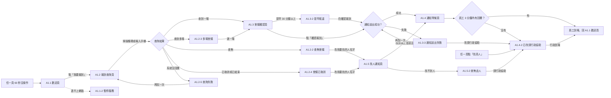

# A1 報到｜順向流程圖

**一句話：** 事前已約好會議的來訪客戶，在櫃檯沒人時走到迎賓機器人前，自己完成報到，讓被約員工收到公務手機通知，並知道在哪裡等候。

## 步驟表

| 步驟 | 頁碼 頁名 | 使用者做什麼 | 畫面怎麼反應 | 打哪支 API |
|---|---|---|---|---|
| 1 | A1.1 歡迎頁 | 走近機器人，點「我要報到」 | 機器人語音問候；進報到查詢頁 | 無 API |
| 2 | A1.2 報到查詢頁 | 把邀請信上的條碼對準鏡頭（或改輸入手機號碼並查詢） | 認到條碼自動查詢，顯示查詢中；查到今天唯一一場會議就直接進會議確認頁 [AI 假設] 只有一場時不必再選 | 查詢今日會議（待後端確認） |
| 3 | A1.3 會議確認頁 | 核對會議時間、會議室、被約員工，點「確認報到」 | 按鈕顯示送出中，完成後進通知等候頁 | 報到並通知被約員工（待後端確認） |
| 4 | A1.4 通知等候頁 | 看「已通知 <員工>」、等候區與會議室怎麼走，等員工回覆 | 通知狀態依序變成已送出 → 已讀 → 員工回覆「馬上到」 | 取得通知狀態（待後端確認） |
| 5 | A1.4 通知等候頁 → A1.1 歡迎頁 | 員工到場接待，訪客離開 | 員工回覆後 30 秒沒有操作，自動回到歡迎頁，清除資料 [AI 假設] 讓下一位訪客看到乾淨畫面 | 無 API |

## 分支與例外

| 發生在 | 頁碼 狀態 | 情況 | 訪客看到／能做什麼 | 接著去哪 | 打哪支 API |
|---|---|---|---|---|---|
| 步驟 2 | A1.2-2 查無會議 | 條碼無效，或手機號碼查不到今天的會議 | 說明查不到，可「改用要找的人名字」或重新查詢 | A1.5 找人通知頁 | 查詢今日會議（待後端確認） |
| 步驟 2 | A1.2-3 多場會議 | 同一號碼今天有 2 場以上會議 | 列出今天的會議（時間、會議室、被約員工），點選一場 | A1.3 會議確認頁 | 查詢今日會議（待後端確認） |
| 步驟 2 | A1.2-4 會議已取消 | 查到的會議已取消或已結束 | 說明會議狀態，可「改用要找的人名字」 | A1.5 找人通知頁 | 查詢今日會議（待後端確認） |
| 步驟 2 | A1.2-5 查詢失敗 | 網路或系統沒回應 | 說明暫時查不到，可再試一次或找真人 | 重試留在本頁；找真人 → A1.4 | 查詢今日會議（待後端確認） |
| 步驟 3 | A1.3-2 提早抵達 | 比會議時間早 30 分鐘以上 | 提示會議時間，仍可確認報到；通知訊息註明「提早抵達」 | A1.4 通知等候頁 | 報到並通知被約員工（待後端確認） |
| 步驟 3 | A1.3-3 通知送出失敗 | 報到或通知沒送出去 | 說明尚未通知成功，可再試一次或改請行政協助 | 重試成功 → A1.4；改請行政 → A1.4-2 | 報到並通知被約員工（待後端確認） |
| 找人 | A1.5 找人通知頁 | 從查無會議、會議已取消進來 | 輸入要找的人名字，選員工，填自己的姓名與公司後送出 | A1.4 通知等候頁 | 搜尋員工、通知員工（待後端確認） |
| 找人 | A1.5-2 查無此人 | 輸入的名字找不到員工 | 說明找不到，可「請行政人員協助」 | A1.4-2 已改請行政協助 | 搜尋員工（待後端確認） |
| 步驟 4 | A1.4-2 已改請行政協助 | 被約員工 3 分鐘沒回覆，或訪客選擇請行政協助 | 顯示「已改請同事協助」與行政人員的回覆狀態 | 行政到場後回 A1.1 | 通知行政人員、取得通知狀態（待後端確認） |
| 任一頁 | — | 點「找真人」 | 通知行政人員 | A1.4-2 已改請行政協助 | 通知行政人員（待後端確認） |
| 任一頁 | — | 60 秒沒有操作 | 清除已輸入的資料 | A1.1 歡迎頁 | 無 API |
| 步驟 1 | A1.1-2 暫停服務 | 機器人連不上網路 | 說明暫時無法報到，顯示行政分機 [AI 假設] 斷線時仍要留一條找得到人的路 | 恢復連線後回 A1.1 | 無 API |

## 流程圖

等候時點「問問題」會進 A2.1 聊天頁，這部分是另一條流程，之後再畫。
